## index.html

```html
<!doctype html>
<html lang="en">
<head>
  <meta charset="utf-8">
  <meta name="viewport" content="width=device-width, initial-scale=1">
  <meta name="referrer" content="strict-origin-when-cross-origin">
  <meta name="color-scheme" content="light dark">
  <meta name="theme-color" content="#F7F5FB" media="(prefers-color-scheme: light)">
  <meta name="theme-color" content="#0B0814" media="(prefers-color-scheme: dark)">
  <meta name="description" content="StudyCafe helps Western students find cafés around London, Ontario to study off campus.">
  <title>StudyCafe — Off campus. On task.</title>
  <link rel="icon" href="data:image/svg+xml,%3Csvg xmlns='http://www.w3.org/2000/svg' viewBox='0 0 32 32'%3E%3Crect width='32' height='32' rx='9' fill='%234F2683'/%3E%3Ccircle cx='16' cy='16' r='7' fill='none' stroke='%23C4B0FF' stroke-width='2'/%3E%3Ccircle cx='16' cy='16' r='2.5' fill='%23fff'/%3E%3C/svg%3E">
  <link rel="preconnect" href="https://fonts.googleapis.com">
  <link rel="preconnect" href="https://fonts.gstatic.com" crossorigin>
  <link href="https://fonts.googleapis.com/css2?family=JetBrains+Mono:wght@400;500&family=Space+Grotesk:wght@400;500;600;700&display=swap" rel="stylesheet">
  <link rel="stylesheet" href="https://unpkg.com/leaflet@1.9.4/dist/leaflet.css">
  <link rel="stylesheet" href="./styles.css">
  <script defer src="https://unpkg.com/leaflet@1.9.4/dist/leaflet.js"></script>
  <script type="module" src="./app.js"></script>
</head>
<body>
  <a class="skip-link" href="#explore">Skip to results</a>
  <nav class="navigation" aria-label="Main navigation">
    <a class="wordmark" href="#top"><span class="brand-icon" aria-hidden="true"></span>StudyCafe<span class="brand-tag">Western</span></a>
    <div class="nav-actions">
      <button id="saved" class="quiet-button" type="button" aria-pressed="false"><span aria-hidden="true">♡</span> <span class="nav-label">Saved</span> <span id="saved-count">0</span></button>
      <button id="theme" class="icon-button" type="button" aria-label="Switch to dark mode" aria-pressed="false">☾</button>
    </div>
  </nav>
  <main id="top">
    <section class="hero" aria-labelledby="hero-title">
      <div class="hero-copy">
        <p class="eyebrow"><span class="pulse-dot" aria-hidden="true"></span>For Western students · London, ON</p>
        <h1 id="hero-title">Off campus.<br>On <em>task.</em></h1>
        <p class="hero-description">Weldon's full again. Find a café nearby, grab a seat with an outlet, and actually get through the readings.</p>
        <dl class="hero-stats">
          <div><dt>Radius</dt><dd>1–10 km</dd></div>
          <div><dt>API keys</dt><dd>Zero</dd></div>
          <div><dt>Tracking</dt><dd>None</dd></div>
        </dl>
      </div>
      <figure class="hero-art" aria-hidden="true"><figcaption>SCANNING · LONDON, ON</figcaption></figure>
    </section>
    <form id="search" class="search-bar" aria-label="Search nearby places">
      <div class="location-field"><span class="location-symbol" aria-hidden="true"></span><div><span class="field-label">Starting point</span><strong>Near my current location</strong><small>Location is shared only when you search</small></div></div>
      <div class="distance-control">
        <label for="radius">Search distance <output id="radius-value" for="radius">2.5 km</output></label>
        <input type="range" id="radius" min="1" max="10" step="0.5" value="2.5" aria-valuetext="2.5 km" aria-describedby="radius-hint">
        <div class="range-ends"><span>1 km</span><span>10 km</span></div>
      </div>
      <button id="locate" class="primary-button" type="submit">Find my spot <span aria-hidden="true">↗</span></button>
    </form>
    <div class="search-caption">
      <div class="caption-actions">
        <button id="from-campus" type="button" class="ghost-button">Search from campus</button>
        <button id="choose-area" type="button" class="ghost-button">Pick an area on the map</button>
        <button id="demo" class="ghost-button" type="button">Try the demo</button>
      </div>
      <small id="radius-hint">Set a distance, then search.</small>
    </div>
    <section class="study-filters" aria-label="Study needs">
      <div class="filters-head"><span class="field-label">Study needs</span><button id="clear-needs" type="button" class="text-button">Clear</button></div>
      <div class="chips">
        <button type="button" class="chip" data-need="quiet" aria-pressed="false">Quiet</button>
        <button type="button" class="chip" id="wifi" data-need="wifi" aria-pressed="false">Wi-Fi</button>
        <button type="button" class="chip" data-need="outlets" aria-pressed="false">Outlets</button>
        <button type="button" class="chip" data-need="late" aria-pressed="false">Open late</button>
        <button type="button" class="chip" data-need="group" aria-pressed="false">Group-friendly</button>
        <button type="button" class="chip" data-need="pets" aria-pressed="false">Pet-friendly</button>
      </div>
      <small class="filter-note">Filters use recorded Wi-Fi and your own study notes. Anything unrecorded stays unknown. Add notes from any card.</small>
    </section>
    <section id="explore" aria-labelledby="results-title">
      <div class="results-heading"><div><p class="eyebrow">Results</p><h2 id="results-title">Your next study spot.</h2></div>
        <div class="view-switch" aria-label="Results view"><button type="button" data-view="split" aria-pressed="true">Split</button><button type="button" data-view="list" aria-pressed="false">List</button><button type="button" data-view="map" aria-pressed="false">Map</button></div>
      </div>
      <div class="results-toolbar"><div class="type-filters" aria-label="Place type"><button type="button" data-filter="all" aria-pressed="true">All</button><button type="button" data-filter="cafe" aria-pressed="false">Cafés</button><button type="button" data-filter="restaurant" aria-pressed="false">Restaurants</button></div><span id="result-count">Ready</span></div>
      <p id="status" role="status">Search near you, from campus, or try the demo. Results are ordered by distance.</p>
      <div class="layout" data-view="split">
        <div id="list-panel">
          <div id="skeletons" hidden aria-hidden="true"><div class="skeleton"></div><div class="skeleton"></div><div class="skeleton"></div></div>
          <ol id="results"><li class="empty-state"><span aria-hidden="true"></span><h3>Nothing scanned yet.</h3><p>Search to see cafés and restaurants around you or around campus.</p></li></ol>
        </div>
        <section id="map-panel" aria-label="Map and selected place">
          <div id="map-placeholder"><span class="map-orbit" aria-hidden="true"></span><h3>Map standby.</h3><p>Search to map spots around<br>you or around campus.</p></div>
          <div id="map" hidden></div><div id="area-controls" hidden><p>Drag or zoom to the area you want, then search its centre. The map starts on Western's campus.</p><button id="search-area" type="button" class="primary-button">Search this area</button></div>
          <div id="detail" aria-live="polite"><p class="detail-hint">Select a place to see details.</p></div>
        </section>
      </div>
    </section>
    <footer>
      <a class="wordmark" href="#top"><span class="brand-icon" aria-hidden="true"></span>StudyCafe</a>
      <p>Built by a Western student, for Western students.</p>
      <small>Independent student project, not affiliated with or endorsed by Western University.<br>Place data © <a href="https://www.openstreetmap.org/copyright">OpenStreetMap contributors</a> · <a href="https://www.openstreetmap.org/fixthemap">Report a map issue</a>. Searches share your location or the chosen point with Overpass. Map tiles load from OpenStreetMap. Venue photos load from Wikimedia Commons when linked and include attribution.</small>
    </footer>
  </main>
  <dialog id="notes-dialog" aria-labelledby="notes-title">
    <form id="notes-form"><p class="eyebrow">Study notes</p><h2 id="notes-title">What's it like?</h2><p id="notes-place"></p><p class="dialog-note">Record what you know. Notes stay in this browser and power the study filters.</p>
    <div id="notes-fields"></div><div class="dialog-actions"><button type="button" id="notes-cancel" class="quiet-button">Cancel</button><button class="primary-button" type="submit">Save notes</button></div></form>
  </dialog>
  <div id="toast" class="toast" role="status" hidden></div>
</body>
</html>

```

## styles.css

```css
/* StudyCafe — Western Edition
   Minimal, purple, a little sci-fi. Every colour is a token; light and dark share one structure. */

:root {
  color-scheme: light;
  --bg: #F7F5FB;
  --surface: rgb(255 255 255 / .72);
  --surface-solid: #FFFFFF;
  --surface-sunken: #EFEBF7;
  --text: #17112A;
  --muted: #5E5873;
  --border: #E2DCEF;
  --border-strong: #CFC4E6;
  --primary: #4F2683;
  --on-primary: #FFFFFF;
  --accent: #6D3FD1;
  --accent-text: #5B2DB8;
  --accent-soft: #EEE7FB;
  --grad-a: #4F2683;
  --grad-b: #8B3FD1;
  --focus: #6D3FD1;
  --glow: rgb(109 63 209 / .28);
  --grid: rgb(79 38 131 / .055);
  --halo: rgb(139 92 246 / .18);
  --success: #1E7A4C;
  --success-soft: #E3F4EA;
  --shadow: 0 1px 2px rgb(23 17 42 / .04), 0 12px 32px rgb(23 17 42 / .06);
  --radius: 14px;
  --radius-sm: 10px;
  --font: "Space Grotesk", ui-sans-serif, system-ui, -apple-system, sans-serif;
  --mono: "JetBrains Mono", ui-monospace, SFMono-Regular, Menlo, monospace;
  --ease: cubic-bezier(.2, .8, .2, 1);
  font: 16px/1.6 var(--font);
}

:root[data-theme="dark"] {
  color-scheme: dark;
  --bg: #0B0814;
  --surface: rgb(22 16 38 / .66);
  --surface-solid: #151025;
  --surface-sunken: #110C1F;
  --text: #F1ECFF;
  --muted: #A79DC2;
  --border: #2A2140;
  --border-strong: #3D3160;
  --primary: #A78BFA;
  --on-primary: #0B0814;
  --accent: #A78BFA;
  --accent-text: #C4B0FF;
  --accent-soft: #221840;
  --grad-a: #C4B0FF;
  --grad-b: #8B6CFF;
  --focus: #C4B0FF;
  --glow: rgb(167 139 250 / .3);
  --grid: rgb(167 139 250 / .06);
  --halo: rgb(124 77 255 / .22);
  --success: #7FDCA8;
  --success-soft: #142A20;
  --shadow: 0 1px 2px rgb(0 0 0 / .3), 0 16px 40px rgb(0 0 0 / .35);
}

/* ---------- Base ---------- */
*, *::before, *::after { box-sizing: border-box; }
html { scroll-behavior: smooth; scroll-padding-top: 96px; }
body {
  margin: 0;
  min-height: 100vh;
  color: var(--text);
  background:
    radial-gradient(900px 520px at 85% -8%, var(--halo), transparent 65%),
    radial-gradient(700px 400px at -10% 30%, var(--halo), transparent 60%),
    linear-gradient(var(--grid) 1px, transparent 1px) 0 0 / 44px 44px,
    linear-gradient(90deg, var(--grid) 1px, transparent 1px) 0 0 / 44px 44px,
    var(--bg);
  -webkit-font-smoothing: antialiased;
}
button, input, select { font: inherit; color: inherit; }
button { cursor: pointer; min-height: 44px; -webkit-tap-highlight-color: transparent; }
button:disabled { cursor: not-allowed; opacity: .55; }
button, a, .cafe-card, .search-bar, .chip { transition: background-color 180ms var(--ease), color 180ms var(--ease), border-color 180ms var(--ease), box-shadow 180ms var(--ease), transform 180ms var(--ease); }
button:active:not(:disabled) { transform: scale(.97); }
:is(button, a, input, select):focus-visible { outline: 2px solid var(--focus); outline-offset: 3px; }
a { color: var(--accent-text); text-underline-offset: 3px; }
[hidden] { display: none !important; }
h1, h2, h3, p { margin: 0; }
h1, h2, h3 { line-height: 1.08; font-weight: 600; letter-spacing: -.03em; }
small { font-size: .8rem; }
::selection { background: var(--accent); color: var(--on-primary); }

.eyebrow, .field-label, .card-kicker, #result-count, .tag, .score, .range-ends, .hero-art figcaption, .venue-facts dt, .brand-tag, .hero-stats dt, .card-index {
  font-family: var(--mono);
  text-transform: uppercase;
  letter-spacing: .1em;
}
.eyebrow, .field-label { font-size: .7rem; font-weight: 500; color: var(--muted); }
.eyebrow { display: inline-flex; align-items: center; gap: 10px; }

/* ---------- Navigation ---------- */
.navigation {
  position: sticky; top: 0; z-index: 1000;
  display: flex; align-items: center; justify-content: space-between; gap: 16px;
  padding: 18px max(24px, calc((100vw - 1200px) / 2));
  background: color-mix(in srgb, var(--bg) 72%, transparent);
  backdrop-filter: blur(16px) saturate(1.4);
  -webkit-backdrop-filter: blur(16px) saturate(1.4);
  border-bottom: 1px solid transparent;
  transition: padding 200ms var(--ease), border-color 200ms var(--ease);
}
.navigation.compact { padding-top: 10px; padding-bottom: 10px; border-bottom-color: var(--border); }
.wordmark { display: inline-flex; align-items: center; gap: 10px; font-weight: 700; font-size: 1.15rem; letter-spacing: -.02em; color: var(--text); text-decoration: none; white-space: nowrap; }
.brand-icon {
  position: relative; width: 30px; height: 30px; border-radius: 9px;
  background: linear-gradient(140deg, var(--grad-a), var(--grad-b));
  box-shadow: 0 0 0 1px var(--border-strong), 0 6px 18px var(--glow);
}
.brand-icon::before { content: ""; position: absolute; inset: 8px; border-radius: 50%; border: 2px solid rgb(255 255 255 / .85); }
.brand-icon::after { content: ""; position: absolute; left: 50%; top: 50%; width: 4px; height: 4px; margin: -2px; border-radius: 50%; background: #fff; }
.brand-tag { font-size: .62rem; font-weight: 500; color: var(--accent-text); border: 1px solid var(--border-strong); border-radius: 999px; padding: 2px 8px; }
.nav-actions { display: flex; gap: 8px; }
.icon-button, .quiet-button {
  border: 1px solid var(--border); border-radius: var(--radius-sm);
  background: var(--surface); padding: 8px 14px;
  backdrop-filter: blur(8px); -webkit-backdrop-filter: blur(8px);
}
.icon-button { width: 44px; padding: 0; }
.icon-button:hover, .quiet-button:hover { border-color: var(--border-strong); }
#saved[aria-pressed="true"] { background: var(--accent-soft); border-color: var(--accent); color: var(--accent-text); }
#saved-count { display: inline-grid; place-items: center; min-width: 22px; height: 22px; margin-left: 4px; padding: 0 6px; border-radius: 999px; background: var(--surface-sunken); font-family: var(--mono); font-size: .72rem; font-variant-numeric: tabular-nums; }

/* ---------- Layout ---------- */
main { max-width: 1248px; margin: auto; padding: 0 24px; }

/* ---------- Hero ---------- */
.hero { display: grid; grid-template-columns: 1.15fr 1fr; align-items: center; gap: 48px; padding: 72px 0 48px; }
.pulse-dot { position: relative; width: 8px; height: 8px; border-radius: 50%; background: var(--accent); }
.pulse-dot::after { content: ""; position: absolute; inset: -4px; border-radius: 50%; border: 1px solid var(--accent); animation: ping 2.4s var(--ease) infinite; }
h1 { font-size: clamp(3rem, 7vw, 5.6rem); letter-spacing: -.055em; margin: 20px 0 22px; }
h1 em {
  font-style: normal;
  background: linear-gradient(95deg, var(--grad-a), var(--grad-b));
  -webkit-background-clip: text; background-clip: text; color: transparent;
}
.hero-description { color: var(--muted); max-width: 30rem; font-size: 1.08rem; }
.hero-stats { display: flex; gap: 32px; margin: 32px 0 0; padding-top: 20px; border-top: 1px solid var(--border); }
.hero-stats dt { font-size: .64rem; color: var(--muted); }
.hero-stats dd { margin: 2px 0 0; font-weight: 600; font-size: 1.05rem; }
.hero-art { margin: 0; position: relative; }
.hero-art::before { content: ""; position: absolute; inset: 10% 8%; border-radius: 40%; background: var(--glow); filter: blur(60px); z-index: -1; }
.hero-art img { display: block; width: 100%; height: auto; border-radius: 24px; border: 1px solid var(--border-strong); box-shadow: var(--shadow); }
.hero-art figcaption { margin-top: 12px; font-size: .64rem; color: var(--muted); text-align: right; }

/* ---------- Search ---------- */
.search-bar {
  display: grid; grid-template-columns: 1.2fr 1fr auto; align-items: center; gap: 24px;
  padding: 18px 18px 18px 24px;
  background: var(--surface); border: 1px solid var(--border); border-radius: 18px;
  box-shadow: var(--shadow);
  backdrop-filter: blur(14px); -webkit-backdrop-filter: blur(14px);
}
.search-bar:focus-within { border-color: var(--accent); box-shadow: 0 0 0 4px var(--glow), var(--shadow); }
.location-field { display: flex; align-items: center; gap: 16px; }
.location-symbol { flex-shrink: 0; position: relative; width: 40px; height: 40px; border-radius: 50%; border: 1px solid var(--border-strong); background: var(--accent-soft); }
.location-symbol::before { content: ""; position: absolute; inset: 11px; border-radius: 50%; border: 2px solid var(--accent); }
.location-symbol::after { content: ""; position: absolute; left: 50%; top: 50%; width: 6px; height: 6px; margin: -3px; border-radius: 50%; background: var(--accent); }
.location-field :is(.field-label, strong, small) { display: block; }
.location-field strong { font-weight: 600; }
.location-field small { color: var(--muted); }
.distance-control { padding-left: 24px; border-left: 1px solid var(--border); }
.distance-control label { display: flex; justify-content: space-between; font-size: .82rem; font-weight: 500; }
.distance-control output { font-family: var(--mono); color: var(--accent-text); font-variant-numeric: tabular-nums; }
#radius { display: block; width: 100%; min-height: 36px; margin: 0; accent-color: var(--accent); }
.range-ends { display: flex; justify-content: space-between; font-size: .62rem; color: var(--muted); }

.primary-button {
  display: inline-flex; align-items: center; justify-content: center; gap: 12px;
  border: 0; border-radius: 12px; padding: 14px 24px;
  background: var(--primary); color: var(--on-primary); font-weight: 600;
  box-shadow: 0 0 0 1px rgb(255 255 255 / .08) inset, 0 8px 24px var(--glow);
}
.primary-button:hover:not(:disabled) { transform: translateY(-1px); box-shadow: 0 0 0 1px rgb(255 255 255 / .12) inset, 0 12px 32px var(--glow); }
.ghost-button { border: 1px solid var(--border); border-radius: 999px; background: transparent; padding: 6px 14px; font-size: .82rem; color: var(--muted); }
.ghost-button:hover { color: var(--accent-text); border-color: var(--accent); }
.text-button { border: 0; background: transparent; padding: 4px 0; color: var(--accent-text); text-decoration: underline; text-underline-offset: 3px; font-size: .85rem; }

.search-caption { display: flex; flex-wrap: wrap; align-items: center; justify-content: space-between; gap: 12px; padding-top: 14px; }
.caption-actions { display: flex; flex-wrap: wrap; gap: 8px; }
#radius-hint { color: var(--muted); }

/* ---------- Study filters ---------- */
.study-filters { padding: 32px 0 40px; }
.filters-head { display: flex; align-items: center; justify-content: space-between; }
.chips { display: flex; flex-wrap: wrap; gap: 8px; margin: 12px 0 10px; }
.chip { display: inline-flex; align-items: center; gap: 8px; padding: 8px 16px; border: 1px solid var(--border); border-radius: 999px; background: var(--surface); font-size: .88rem; }
.chip::before { content: ""; width: 6px; height: 6px; border-radius: 50%; border: 1px solid var(--muted); transition: inherit; }
.chip:hover { border-color: var(--border-strong); }
.chip[aria-pressed="true"] { color: var(--accent-text); background: var(--accent-soft); border-color: var(--accent); }
.chip[aria-pressed="true"]::before { background: var(--accent); border-color: var(--accent); box-shadow: 0 0 8px var(--accent); }
.filter-note { display: block; color: var(--muted); }

/* ---------- Results ---------- */
.results-heading { display: flex; align-items: flex-end; justify-content: space-between; gap: 16px; padding-top: 32px; border-top: 1px solid var(--border); }
.results-heading h2 { font-size: clamp(1.8rem, 3.5vw, 2.4rem); margin-top: 8px; }
.view-switch, .type-filters { display: flex; gap: 2px; padding: 4px; border: 1px solid var(--border); border-radius: 12px; background: var(--surface-sunken); }
.view-switch button, .type-filters button { min-height: 36px; border: 0; border-radius: 8px; background: transparent; padding: 4px 14px; font-size: .85rem; color: var(--muted); }
.view-switch button:hover, .type-filters button:hover { color: var(--text); }
.view-switch button[aria-pressed="true"], .type-filters button[aria-pressed="true"] { background: var(--surface-solid); color: var(--text); box-shadow: 0 1px 3px rgb(0 0 0 / .12), 0 0 0 1px var(--border); }
.results-toolbar { display: flex; align-items: center; justify-content: space-between; gap: 16px; margin-top: 20px; }
#result-count { font-size: .68rem; color: var(--muted); }
#status { min-height: 52px; padding: 14px 0 18px; font-family: var(--mono); font-size: .78rem; color: var(--muted); }
#status::before { content: "> "; color: var(--accent-text); }

.layout { display: grid; grid-template-columns: minmax(0, 1fr) minmax(0, 1fr); gap: 24px; align-items: start; }
.layout[data-view="list"], .layout[data-view="map"] { grid-template-columns: 1fr; }
.layout[data-view="list"] #map-panel, .layout[data-view="map"] #list-panel { display: none; }
#results { display: grid; gap: 12px; margin: 0; padding: 0; list-style: none; }
.layout[data-view="list"] #results { grid-template-columns: repeat(auto-fill, minmax(min(100%, 380px), 1fr)); }

/* ---------- Cards ---------- */
.cafe-card {
  position: relative; padding: 18px;
  background: var(--surface); border: 1px solid var(--border); border-radius: var(--radius);
  backdrop-filter: blur(10px); -webkit-backdrop-filter: blur(10px);
}
.cafe-card:hover, .cafe-card.highlight { border-color: var(--border-strong); transform: translateY(-2px); box-shadow: 0 12px 32px var(--glow); }
.cafe-card.selected { border-color: var(--accent); box-shadow: inset 3px 0 0 var(--accent), 0 0 0 3px var(--accent-soft); }
.card-top { display: flex; align-items: flex-start; gap: 14px; }
.card-index {
  flex-shrink: 0; display: grid; place-items: center; width: 44px; height: 44px;
  border-radius: 12px; border: 1px solid var(--border-strong); background: var(--surface-sunken);
  font-size: .8rem; font-weight: 500; letter-spacing: .02em; color: var(--accent-text);
}
.cafe-card.selected .card-index { background: var(--primary); border-color: var(--primary); color: var(--on-primary); }
.card-main { flex: 1; min-width: 0; }
.card-kicker { font-size: .62rem; color: var(--muted); }
.card-select { display: block; min-height: 0; padding: 2px 0 4px; border: 0; background: transparent; text-align: left; font-size: 1.12rem; font-weight: 600; line-height: 1.3; letter-spacing: -.01em; overflow-wrap: anywhere; }
.card-select:hover { color: var(--accent-text); }
.card-meta, .card-address { font-size: .8rem; color: var(--muted); }
.card-meta { font-family: var(--mono); font-size: .72rem; }
.card-address { margin-top: 2px; }
.favorite { flex-shrink: 0; width: 44px; height: 44px; border: 1px solid var(--border); border-radius: 50%; background: transparent; font-size: 1.25rem; line-height: 1; color: var(--muted); }
.favorite:hover { color: var(--accent-text); border-color: var(--accent); }
.favorite[aria-pressed="true"] { background: var(--primary); border-color: var(--primary); color: var(--on-primary); box-shadow: 0 0 16px var(--glow); }
.favorite.pulse { animation: pop 260ms var(--ease); }
.card-bottom { display: flex; flex-wrap: wrap; align-items: center; gap: 8px; margin-top: 14px; padding-top: 12px; border-top: 1px dashed var(--border); }
.tag { padding: 3px 8px; border-radius: 6px; font-size: .6rem; color: var(--success); background: var(--success-soft); }
.tag.unknown { color: var(--muted); background: var(--surface-sunken); }
.score { display: flex; align-items: center; gap: 8px; margin-left: auto; font-size: .6rem; color: var(--muted); }
.score-ring { display: grid; place-items: center; width: 28px; height: 28px; border-radius: 50%; border: 2px dashed var(--border-strong); }
.cafe-card > .text-button { margin-top: 8px; font-size: .8rem; }

/* ---------- Map + detail ---------- */
#map-panel { position: sticky; top: 84px; overflow: hidden; background: var(--surface); border: 1px solid var(--border); border-radius: 18px; box-shadow: var(--shadow); backdrop-filter: blur(14px); -webkit-backdrop-filter: blur(14px); }
#map, #map-placeholder { height: 420px; }
#map-placeholder {
  display: flex; flex-direction: column; align-items: center; justify-content: center; padding: 24px; text-align: center;
  background:
    radial-gradient(circle at center, var(--accent-soft) 0, transparent 60%),
    repeating-radial-gradient(circle at center, transparent 0 38px, var(--grid) 38px 39px),
    var(--surface-sunken);
}
#map-placeholder h3 { font-size: 1.3rem; }
#map-placeholder p { margin-top: 10px; font-size: .9rem; color: var(--muted); }
.map-orbit { position: relative; width: 88px; height: 88px; margin-bottom: 24px; border-radius: 50%; border: 1px solid var(--border-strong); }
.map-orbit::before { content: ""; position: absolute; inset: 0; border-radius: 50%; background: conic-gradient(from 0deg, var(--glow), transparent 30%); animation: spin 3.6s linear infinite; }
.map-orbit::after { content: ""; position: absolute; left: 50%; top: 50%; width: 10px; height: 10px; margin: -5px; border-radius: 50%; background: var(--accent); box-shadow: 0 0 16px var(--accent); }
#area-controls { padding: 16px; background: var(--surface-sunken); border-top: 1px solid var(--border); }
#area-controls p { margin-bottom: 12px; font-size: .82rem; color: var(--muted); }
#detail { padding: 24px; border-top: 1px solid var(--border); }
#detail h2 { margin-bottom: 10px; font-size: 1.5rem; }
#detail p { margin-bottom: 6px; font-size: .88rem; }
#detail small { display: block; color: var(--muted); }
#detail > a { display: inline-flex; align-items: center; min-height: 44px; margin-top: 8px; font-size: .88rem; font-weight: 600; }
.detail-hint { color: var(--muted); }

.venue-facts { display: grid; grid-template-columns: auto minmax(0, 1fr); gap: 10px 20px; margin: 16px 0; padding: 16px 0; border-top: 1px solid var(--border); border-bottom: 1px solid var(--border); }
.venue-facts dt { font-size: .62rem; color: var(--muted); padding-top: 3px; }
.venue-facts dd { margin: 0; font-size: .86rem; overflow-wrap: anywhere; white-space: pre-wrap; }
#detail .venue-facts a { margin: 0; }
.venue-photo { margin: 20px 0 0; }
.venue-photo img { width: 100%; height: auto; border-radius: var(--radius-sm); border: 1px solid var(--border); }
.venue-photo figcaption { margin-top: 6px; font-size: .74rem; color: var(--muted); overflow-wrap: anywhere; }
#detail .venue-photo a { font-size: inherit; }

/* Leaflet */
.leaflet-container { font-family: var(--font); background: var(--surface-sunken); }
:root[data-theme="dark"] .leaflet-tile-pane { filter: invert(1) hue-rotate(200deg) brightness(.92) contrast(.9) saturate(.55); }
.leaflet-popup-content-wrapper, .leaflet-popup-tip { background: #FFFFFF; color: #17112A; }
.leaflet-popup-content-wrapper { border-radius: 10px; font-weight: 600; }
.leaflet-control-attribution { background: rgb(255 255 255 / .9) !important; color: #17112A; }
.leaflet-control-attribution a { color: #4F2683; }
.leaflet-control-zoom a { width: 44px !important; height: 44px !important; line-height: 44px !important; }
.study-pin { border: 0; background: transparent; }
.study-pin span {
  position: relative; display: grid; place-items: center; width: 34px; height: 34px; margin: 0 auto;
  border-radius: 50%; background: #4F2683; border: 2px solid #FFFFFF;
  box-shadow: 0 0 0 4px rgb(79 38 131 / .22), 0 6px 16px rgb(79 38 131 / .45);
  color: #FFFFFF; font: 600 12px/1 var(--mono);
  transform-origin: 50% 100%;
  transition: transform 180ms var(--ease), background-color 180ms var(--ease);
}
.study-pin span::after { content: ""; position: absolute; left: 50%; bottom: -9px; margin-left: -5px; border: 5px solid transparent; border-top-color: #FFFFFF; }
.study-pin.highlight span { background: #A78BFA; color: #0B0814; transform: translateY(-4px) scale(1.12); }

/* ---------- States ---------- */
.empty-state { padding: 56px 24px; text-align: center; border: 1px dashed var(--border-strong); border-radius: var(--radius); background: var(--surface); }
.empty-state > span { display: block; width: 44px; height: 44px; margin: 0 auto 18px; border-radius: 50%; border: 1px solid var(--border-strong); background: radial-gradient(circle, var(--accent) 0 4px, transparent 5px); }
.empty-state h3 { font-size: 1.2rem; }
.empty-state p { margin-top: 10px; font-size: .9rem; color: var(--muted); }
.skeleton { position: relative; overflow: hidden; height: 148px; margin-bottom: 12px; border: 1px solid var(--border); border-radius: var(--radius); background: var(--surface-sunken); }
.skeleton::after { content: ""; position: absolute; inset: 0; transform: translateX(-100%); background: linear-gradient(90deg, transparent, var(--glow), transparent); animation: sweep 1.4s var(--ease) infinite; }

/* ---------- Dialog + toast ---------- */
#notes-dialog { width: min(480px, calc(100% - 32px)); max-height: 85vh; overflow: auto; padding: 28px; color: var(--text); background: var(--surface-solid); border: 1px solid var(--border-strong); border-radius: 18px; box-shadow: 0 24px 80px rgb(0 0 0 / .35); }
#notes-dialog::backdrop { background: rgb(11 8 20 / .55); backdrop-filter: blur(6px); -webkit-backdrop-filter: blur(6px); }
#notes-dialog h2 { margin-top: 8px; font-size: 1.6rem; }
#notes-place { margin-top: 4px; font-weight: 600; color: var(--accent-text); }
.dialog-note { margin: 12px 0 8px; font-size: .86rem; color: var(--muted); }
#notes-fields label { display: flex; align-items: center; justify-content: space-between; gap: 12px; padding: 10px 0; border-bottom: 1px solid var(--border); }
#notes-fields select { min-height: 40px; padding: 6px 10px; border: 1px solid var(--border-strong); border-radius: 8px; background: var(--surface-sunken); }
.dialog-actions { display: flex; justify-content: flex-end; gap: 8px; margin-top: 20px; }

.toast { position: fixed; bottom: 24px; left: 50%; z-index: 1100; max-width: calc(100% - 32px); transform: translateX(-50%); padding: 12px 20px; border: 1px solid var(--border-strong); border-radius: 999px; background: var(--surface-solid); color: var(--text); box-shadow: 0 12px 40px var(--glow); font-size: .9rem; }
.skip-link { position: absolute; top: -100px; left: 16px; z-index: 1200; padding: 12px 16px; border-radius: 10px; background: var(--primary); color: var(--on-primary); }
.skip-link:focus { top: 12px; }

/* ---------- Footer ---------- */
footer { margin-top: 80px; padding: 32px 0 48px; border-top: 1px solid var(--border); }
footer p { margin: 10px 0 16px; font-size: .9rem; color: var(--muted); }
footer small { display: block; max-width: 60rem; color: var(--muted); line-height: 1.7; }

/* ---------- Motion ---------- */
.reveal { animation: rise 320ms var(--ease) both; }
@keyframes rise { from { opacity: 0; transform: translateY(8px); } to { opacity: 1; transform: none; } }
@keyframes pop { 50% { transform: scale(1.18); } }
@keyframes sweep { to { transform: translateX(100%); } }
@keyframes spin { to { transform: rotate(1turn); } }
@keyframes ping { 0% { transform: scale(.6); opacity: 1; } 80%, 100% { transform: scale(2.2); opacity: 0; } }

/* ---------- Responsive ---------- */
@media (max-width: 900px) {
  .hero { grid-template-columns: 1fr; gap: 32px; padding-top: 48px; }
  .hero-art { max-width: 520px; }
  .search-bar { grid-template-columns: 1fr 1fr; }
  .search-bar .primary-button { grid-column: 1 / -1; }
  .layout { grid-template-columns: 1fr; }
  #map-panel { position: static; }
}
@media (max-width: 560px) {
  main { padding: 0 16px; }
  .navigation { padding: 12px 16px; }
  .brand-tag { display: none; }
  .nav-label { position: absolute; width: 1px; height: 1px; overflow: hidden; clip-path: inset(50%); white-space: nowrap; }
  .hero { padding: 32px 0 24px; }
  .hero-art { display: none; }
  .hero-stats { gap: 20px; }
  .search-bar { grid-template-columns: 1fr; gap: 16px; padding: 18px; }
  .distance-control { padding: 16px 0 0; border-left: 0; border-top: 1px solid var(--border); }
  .results-heading, .results-toolbar { flex-direction: column; align-items: flex-start; }
  .card-top { flex-wrap: wrap; }
  .score { margin-left: 0; }
  #map, #map-placeholder { height: 320px; }
}
@media (prefers-reduced-motion: reduce) {
  html { scroll-behavior: auto; }
  *, *::before, *::after { animation: none !important; transition: none !important; }
}

```

## app.js

```javascript
import { renderExtraDetails } from './details.js';
import { TILE_URL, OVERPASS_URL, CAMPUS } from './config.js';
import { initializeUI, matchesPreferences, createCard, beforeRender, showCount, setBusy } from './ui.js';

const get = (id) => document.getElementById(id);
const results = get('results');
const status = get('status');
let cafes = [];
let map;
let markers = [];
let lastRequest = 0;
let cachedSearch;
let filter = 'all';
let activeName;
let demoMode = false;
const CONTROLS = ['locate', 'demo', 'radius', 'choose-area', 'search-area', 'from-campus'];

function locate() {
  return new Promise((resolve, reject) => {
    if (!navigator.geolocation) {
      reject(new Error('Location is unavailable. Open this app on localhost or HTTPS.'));
      return;
    }
    navigator.geolocation.getCurrentPosition(
      ({ coords }) => resolve({ lat: coords.latitude, lng: coords.longitude }),
      ({ code }) => reject(new Error(code === 1
        ? 'Location access was denied. Allow location in your browser settings or try the demo.'
        : 'Your location could not be determined. Try again or use the demo.')),
      { timeout: 10000, maximumAge: 60000 },
    );
  });
}

function distanceKm(from, to) {
  const rad = (degrees) => degrees * Math.PI / 180;
  const a = Math.sin(rad(to.lat - from.lat) / 2) ** 2
    + Math.cos(rad(from.lat)) * Math.cos(rad(to.lat))
    * Math.sin(rad(to.lng - from.lng) / 2) ** 2;
  return 12742 * Math.asin(Math.sqrt(Math.min(1, a)));
}

function addText(parent, tag, content) {
  const element = document.createElement(tag);
  element.textContent = content;
  parent.append(element);
  return element;
}

function showCafe(cafe) {
  activeName = cafe.id;
  render();
  if (!cafe.marker) return;
  map.panTo(cafe.location, { animate: !window.matchMedia('(prefers-reduced-motion: reduce)').matches });
  cafe.marker.openPopup();
}

function render() {
  const visible = cafes.filter(cafe => (filter === 'all' || cafe.types.includes(filter)) && matchesPreferences(cafe))
    .sort((a, b) => a.distance - b.distance);
  for (const cafe of cafes) {
    if (cafe.marker) {
      if (visible.includes(cafe)) cafe.marker.addTo(map);
      else cafe.marker.remove();
    }
  }
  const selected = visible.find(cafe => cafe.id === activeName) ?? visible[0];
  activeName = selected?.id;
  const focusedId = document.activeElement?.dataset.selectId;
  beforeRender();
  results.replaceChildren();
  showCount(visible.length);
  get('detail').replaceChildren();
  for (const cafe of visible) {
    results.append(createCard(cafe, cafe === selected, showCafe));
  }
  if (focusedId) {
    for (const button of results.querySelectorAll('[data-select-id]')) {
      if (button.dataset.selectId === focusedId) button.focus({ preventScroll: true });
    }
  }
  if (!selected) {
    const empty = addText(results, 'li', '', 'empty-state');
    empty.className = 'empty-state';
    addText(empty, 'h3', 'No matches.');
    addText(empty, 'p', 'No matching places. Try another type, clear study filters or turn off Saved, or search a wider area. Saved places are shown within the current search results.');
    addText(get('detail'), 'p', 'No place selected.');
    return;
  }
  addText(get('detail'), 'h2', selected.name);
  addText(get('detail'), 'p', selected.address);
  addText(get('detail'), 'p', selected.distance.toFixed(2) + ' km away' + (Number.isFinite(selected.campusDistance) ? ' · ' + selected.campusDistance.toFixed(1) + ' km from Western campus' : '') + ' · straight-line');
  addText(get('detail'), 'p', 'Internet access · ' + (selected.internet ?? 'Not recorded'));
  addText(get('detail'), 'small', 'Noise levels, outlets and study suitability are unverified.');
  renderExtraDetails(get('detail'), selected);
  if (selected.url) {
    const link = addText(get('detail'), 'a', 'Open in OpenStreetMap ↗');
    link.href = selected.url;
    link.target = '_blank';
    link.rel = 'noopener noreferrer';
  } else {
    addText(get('detail'), 'small', 'Fictional demo listing · Live search adds map links.');
  }
}

function clearMarkers() {
  map?.closePopup();
  for (const marker of markers) marker.remove();
  markers = [];
}

document.querySelectorAll('[data-filter]').forEach(button => {
  button.addEventListener('click', () => {
    filter = button.dataset.filter;
    document.querySelectorAll('[data-filter]').forEach(chip => chip.setAttribute('aria-pressed', chip === button));
    map?.closePopup();
    render();
  });
});
function showDemo() {
  demoMode = true;
  clearMarkers();
  get('area-controls').hidden = true;
  get('map').hidden = true;
  get('map-placeholder').hidden = false;
  get('map-placeholder').textContent = 'Demo listings are fictional. Search near you or from campus to see the live map.';
  const radiusKm = Number(get('radius').value);
  cafes = [
    { types: ['cafe'], name: 'Violet Hour Coffee', address: 'Demo café · Richmond Row', rating: 4.8, distance: 0.65 },
    { types: ['cafe'], name: 'Margin Notes Café', address: 'Demo café · Near campus', rating: 4.6, distance: 0.32 },
    { types: ['restaurant'], name: 'The Study Table', address: 'Demo restaurant · Old East Village', rating: 4.4, distance: 1.14 },
    { types: ['cafe'], name: 'Late Shift Espresso', address: 'Demo café · Downtown', rating: 4.7, distance: 3.5 },
    { types: ['cafe'], name: 'Quiet Quarter', address: 'Demo café · Wortley Village', rating: 4.5, distance: 7.5 },
  ].sort((a, b) => a.distance - b.distance)
    .map((cafe, index) => ({ ...cafe, id: 'demo-' + index, pin: index + 1 }))
    .filter((cafe) => cafe.distance <= radiusKm);
  status.textContent = `Demo: ${cafes.length} fictional spots within ${radiusKm} km. No location is used.`;
  render();
}
get('demo').addEventListener('click', showDemo);
get('radius').addEventListener('input', () => {
  const distance = get('radius').value + ' km';
  get('radius-value').textContent = distance;
  get('radius').setAttribute('aria-valuetext', distance);
  if (demoMode) showDemo();
});

async function searchPlaces(event) {
  event.preventDefault();
  const radius = Number(get('radius').value) * 1000;
  for (const id of CONTROLS) get(id).disabled = true;
  setBusy(true);
  status.textContent = event.submitter?.id === 'locate' || !event.submitter ? 'Getting your location…' : 'Preparing search…';
  try {
    let center;
    const origin = event.submitter?.id;
    if (origin === 'search-area') {
      center = map.getCenter();
    } else if (origin === 'from-campus') {
      center = { lat: CAMPUS.lat, lng: CAMPUS.lng };
    } else {
      try {
        center = await locate();
      } catch (error) {
        openAreaPicker();
        throw new Error(error.message + ' Choose your area on the map and click Search this map area.');
      }
    }
    status.textContent = 'Searching for nearby places…';
    if (!window.L) throw new Error('The map library could not load. Check your connection and reload.');
    const cacheKey = [center.lat, center.lng, radius].join(',');
    let elements;
    if (cachedSearch?.key === cacheKey && Date.now() - cachedSearch.time < 300000) {
      elements = cachedSearch.elements;
    } else {
      if (Date.now() - lastRequest < 15000) throw new Error('Please wait 15 seconds between searches.');
      lastRequest = Date.now();
      const query = '[out:json][timeout:25];nwr["amenity"~"^(cafe|restaurant)$"](around:' +
        radius + ',' + center.lat + ',' + center.lng + ');out center tags;';
      const controller = new AbortController();
      const timeout = setTimeout(() => controller.abort(), 30000);
      try {
        const response = await fetch(OVERPASS_URL, {
          method: 'POST', body: new URLSearchParams({ data: query }), signal: controller.signal,
        });
        if (!response.ok) throw new Error('The public search service is busy (' + response.status + '). Try again later.');
        const data = await response.json();
        if (data.remark || !Array.isArray(data.elements)) throw new Error('The search service could not complete the request. Try a smaller radius.');
        elements = data.elements;
        cachedSearch = { key: cacheKey, time: Date.now(), elements };
      } finally {
        clearTimeout(timeout);
      }
    }
    const nextCafes = elements.map(element => {
      const point = element.center ?? element;
      if (!Number.isFinite(point.lat) || !Number.isFinite(point.lon)) return null;
      const tags = element.tags ?? {};
      const location = { lat: point.lat, lng: point.lon };
      return {
        id: element.type + '/' + element.id,
        name: tags.name ?? tags.brand ?? 'Unnamed ' + tags.amenity,
        types: [tags.amenity], location,
        distance: distanceKm(center, location),
        campusDistance: distanceKm(CAMPUS, location),
        address: [tags['addr:housenumber'], tags['addr:street'], tags['addr:city']].filter(Boolean).join(' ') || 'Address not recorded',
        internet: tags.internet_access,
        website: tags.website ?? tags['contact:website'],
        phone: tags.phone ?? tags['contact:phone'],
        cuisine: tags.cuisine,
        openingHours: tags.opening_hours,
        commons: tags.wikimedia_commons,
        image: tags.image,
        url: 'https://www.openstreetmap.org/' + element.type + '/' + element.id,
      };
    }).filter(cafe => cafe && cafe.distance <= radius / 1000);
    demoMode = false;
    clearMarkers();
    get('map').hidden = false;
    get('map-placeholder').hidden = true;
    ensureMap(center);
    map.invalidateSize();
    map.setView(center, 14);
    cafes = nextCafes.sort((a, b) => a.distance - b.distance);
    for (const cafe of cafes) {
      const markerNumber = markers.length + 1;
      cafe.pin = markerNumber;
      cafe.marker = L.marker(cafe.location, {
        title: cafe.name,
        icon: L.divIcon({ className: 'study-pin', html: '<span>' + markerNumber + '</span>', iconSize: [34, 44], iconAnchor: [17, 44], popupAnchor: [0, -40] }),
      }).bindPopup(document.createTextNode(cafe.name));
      cafe.marker.on('mouseover', () => highlightCafe(cafe.id, true));
      cafe.marker.on('mouseout', () => highlightCafe(cafe.id, false));
      cafe.marker.on('add', () => {
        const element = cafe.marker.getElement();
        element.onfocus = () => highlightCafe(cafe.id, true);
        element.onblur = () => highlightCafe(cafe.id, false);
      });
      cafe.marker.on('click', () => showCafe(cafe));
      markers.push(cafe.marker);
    }
    if (cafes.length) map.fitBounds(L.latLngBounds([center, ...cafes.map(cafe => cafe.location)]), { padding: [30, 30], maxZoom: 16 });
    status.textContent = cafes.length
      ? `Found ${cafes.length} spots within ${radius / 1000} km of ${origin === 'from-campus' ? 'Western campus' : origin === 'search-area' ? 'the map centre' : 'you'}. Distances are straight-line.`
      : 'No places found in that radius. Try a wider distance or another area.';
    render();
  } catch (error) {
    status.textContent = `Search failed. ${error.name === 'AbortError' ? 'The search timed out. Try a smaller radius.' : (error.message ?? 'Try again or use the demo.')}`;
  } finally {
    setBusy(false);
    for (const id of CONTROLS) get(id).disabled = false;
  }
}
get('search').addEventListener('submit', searchPlaces);
get('search-area').addEventListener('click', () => searchPlaces({ preventDefault() {}, submitter: get('search-area') }));
get('from-campus').addEventListener('click', () => searchPlaces({ preventDefault() {}, submitter: get('from-campus') }));

function highlightCafe(id, highlighted) {
  for (const card of results.querySelectorAll('[data-place-id]')) {
    if (card.dataset.placeId === id) card.classList.toggle('highlight', highlighted);
  }
  const cafe = cafes.find(place => place.id === id);
  cafe?.marker?.getElement()?.classList.toggle('highlight', highlighted);
}

initializeUI(render, highlightCafe, () => map?.invalidateSize());

function ensureMap(center) {
  if (!window.L) throw new Error('The map library could not load. Check your connection and reload.');
  get('map').hidden = false;
  get('map-placeholder').hidden = true;
  if (!map) {
    map = L.map('map').setView(center, 14);
    L.tileLayer(TILE_URL, {
      maxZoom: 19,
      attribution: '&copy; <a href="https://www.openstreetmap.org/copyright">OpenStreetMap</a> contributors',
    }).addTo(map);
  }
  map.invalidateSize();
}

function openAreaPicker() {
  document.querySelector('.layout').dataset.view = 'split';
  document.querySelectorAll('.view-switch button').forEach(button => button.setAttribute('aria-pressed', button.dataset.view === 'split'));
  ensureMap({ lat: CAMPUS.lat, lng: CAMPUS.lng });
  get('area-controls').hidden = false;
  get('map-panel').scrollIntoView({ block: 'nearest' });
  requestAnimationFrame(() => map.invalidateSize());
}
get('choose-area').addEventListener('click', () => {
  try { openAreaPicker(); }
  catch (error) { status.textContent = error.message; }
});

```

## ui.js

```javascript
// Presentation state stays separate from the place objects returned by the search.
const get = id => document.getElementById(id);
let saved = new Set();
let savedOnly = false;
const selectedNeeds = new Set();
const needLabels = { quiet: 'Quiet', wifi: 'Wi-Fi', outlets: 'Power outlets', late: 'Open late (after 9 pm)', group: 'Group-friendly', pets: 'Pet-friendly' };
let notes = {};
let editingCafe;
try {
  const storedNotes = JSON.parse(localStorage.getItem('studycafe-notes') ?? '{}');
  if (storedNotes && typeof storedNotes === 'object' && !Array.isArray(storedNotes)) notes = storedNotes;
} catch { /* Keep notes in memory when storage is unavailable. */ }
let toastTimer;
let refresh;
let highlight;
let observer;
try {
  const stored = JSON.parse(localStorage.getItem('studycafe-saved') ?? '[]');
  if (Array.isArray(stored)) saved = new Set(stored.filter(id => typeof id === 'string'));
} catch { /* Saved places remain available for this session. */ }

export function matchesPreferences(cafe) {
  return (!savedOnly || saved.has(cafe.id)) && [...selectedNeeds].every(need => featureValue(cafe, need) === 'yes');
}

function featureValue(cafe, need) {
  const value = notes[cafe.id]?.[need];
  if (value === 'yes' || value === 'no') return value;
  if (need === 'wifi' && cafe.internet === 'wlan') return 'yes';
  return 'unknown';
}

function openNotes(cafe) {
  editingCafe = cafe;
  get('notes-place').textContent = cafe.name;
  get('notes-fields').replaceChildren();
  for (const [key, labelText] of Object.entries(needLabels)) {
    const label = document.createElement('label');
    text(label, 'span', labelText);
    const select = document.createElement('select');
    select.name = key;
    for (const [value, caption] of [['unknown', 'Unknown'], ['yes', 'Yes'], ['no', 'No']]) {
      const option = document.createElement('option');
      option.value = value;
      option.textContent = caption;
      select.append(option);
    }
    select.value = notes[cafe.id]?.[key] ?? 'unknown';
    label.append(select);
    get('notes-fields').append(label);
  }
  get('notes-dialog').showModal();
}

function text(parent, tag, value, className) {
  const element = document.createElement(tag);
  element.textContent = value;
  if (className) element.className = className;
  parent.append(element);
  return element;
}

function notify(message) {
  clearTimeout(toastTimer);
  get('toast').textContent = message;
  get('toast').hidden = false;
  toastTimer = setTimeout(() => { get('toast').hidden = true; }, 2500);
}

function updateSavedCount() {
  get('saved-count').textContent = saved.size;
}

function toggleSave(cafe, button) {
  if (saved.has(cafe.id)) saved.delete(cafe.id);
  else saved.add(cafe.id);
  try {
    localStorage.setItem('studycafe-saved', JSON.stringify([...saved]));
  } catch {
    notify('Saved for this session. Browser storage is unavailable.');
  }
  button.setAttribute('aria-pressed', saved.has(cafe.id));
  button.setAttribute('aria-label', (saved.has(cafe.id) ? 'Unsave ' : 'Save ') + cafe.name);
  button.textContent = saved.has(cafe.id) ? '♥' : '♡';
  button.classList.remove('pulse');
  requestAnimationFrame(() => button.classList.add('pulse'));
  updateSavedCount();
  if (savedOnly) {
    refresh();
    get('saved').focus();
  }
}

export function createCard(cafe, selected, onSelect) {
  const item = document.createElement('li');
  item.className = 'cafe-card' + (selected ? ' selected' : '');
  item.dataset.placeId = cafe.id;
  const top = document.createElement('div');
  top.className = 'card-top';
  item.append(top);
  const index = text(top, 'span', cafe.pin != null ? String(cafe.pin).padStart(2, '0') : '—', 'card-index');
  index.setAttribute('aria-hidden', 'true');
  const main = document.createElement('div');
  main.className = 'card-main';
  top.append(main);
  text(main, 'p', cafe.types[0] === 'restaurant' ? 'Restaurant' : 'Café', 'card-kicker');
  const select = text(main, 'button', cafe.name, 'card-select');
  select.type = 'button';
  select.dataset.selectId = cafe.id;
  select.setAttribute('aria-pressed', selected);
  select.addEventListener('click', () => {
    onSelect(cafe);
    document.querySelector('.layout').dataset.view = 'split';
    document.querySelectorAll('.view-switch button').forEach(button => button.setAttribute('aria-pressed', button.dataset.view === 'split'));
    window.dispatchEvent(new Event('resize'));
    get('detail').scrollIntoView({ block: 'nearest' });
  });
  const rating = Number.isFinite(cafe.rating) ? '★ ' + cafe.rating.toFixed(1) + ' · Sample rating' : 'Rating unavailable';
  const campus = Number.isFinite(cafe.campusDistance) ? ' · ' + cafe.campusDistance.toFixed(1) + ' km from campus' : '';
  text(main, 'p', cafe.distance.toFixed(2) + ' km away' + campus + ' · ' + rating, 'card-meta');
  text(main, 'p', cafe.address, 'card-address');
  const save = text(top, 'button', saved.has(cafe.id) ? '♥' : '♡', 'favorite');
  save.type = 'button';
  save.setAttribute('aria-pressed', saved.has(cafe.id));
  save.setAttribute('aria-label', (saved.has(cafe.id) ? 'Unsave ' : 'Save ') + cafe.name);
  save.addEventListener('click', () => toggleSave(cafe, save));
  const bottom = document.createElement('div');
  bottom.className = 'card-bottom';
  item.append(bottom);
  text(bottom, 'span', cafe.internet === 'wlan' ? 'Wi-Fi recorded' : 'Wi-Fi unverified',
    cafe.internet === 'wlan' ? 'tag' : 'tag unknown');
  text(bottom, 'span', cafe.openingHours ? 'Hours in details' : 'Hours unavailable', 'tag unknown');
  const score = document.createElement('div');
  score.className = 'score';
  score.setAttribute('aria-label', 'Study Score unavailable. Noise, seating, Wi-Fi and outlet data are incomplete.');
  text(score, 'span', '—', 'score-ring');
  text(score, 'span', 'Study Score pending');
  bottom.append(score);
  for (const key of Object.keys(needLabels)) {
    if (notes[cafe.id]?.[key] === 'yes') text(bottom, 'span', needLabels[key] + ' · Your note', 'tag');
  }
  const editNotes = text(item, 'button', 'Add / edit study notes', 'text-button');
  editNotes.type = 'button';
  editNotes.addEventListener('click', () => openNotes(cafe));
  item.addEventListener('mouseenter', () => highlight(cafe.id, true));
  item.addEventListener('mouseleave', () => highlight(cafe.id, false));
  item.addEventListener('focusin', () => highlight(cafe.id, true));
  item.addEventListener('focusout', event => {
    if (!item.contains(event.relatedTarget)) highlight(cafe.id, false);
  });
  observer?.observe(item);
  return item;
}

export function beforeRender() {
  observer?.disconnect();
}

export function showCount(count) {
  get('result-count').textContent = count + (count === 1 ? ' spot' : ' spots') + ' · Nearest first';
}

export function setBusy(busy) {
  get('list-panel').setAttribute('aria-busy', busy);
  get('skeletons').hidden = !busy;
  get('results').hidden = busy;
  const arrow = document.createElement('span');
  arrow.setAttribute('aria-hidden', 'true');
  arrow.textContent = busy ? '' : '↗';
  get('locate').replaceChildren(busy ? 'Scanning…' : 'Find my spot', arrow);
}

export function initializeUI(onRefresh, onHighlight, onMapResize) {
  refresh = onRefresh;
  highlight = onHighlight;
  updateSavedCount();
  const preference = window.matchMedia('(prefers-color-scheme: dark)');
  let themeChoice;
  try { themeChoice = localStorage.getItem('studycafe-theme'); } catch { /* Use device theme. */ }
  const applyTheme = dark => {
    document.documentElement.dataset.theme = dark ? 'dark' : 'light';
    get('theme').textContent = dark ? '☀' : '☾';
    get('theme').setAttribute('aria-pressed', dark);
    get('theme').setAttribute('aria-label', dark ? 'Switch to light mode' : 'Switch to dark mode');
  };
  applyTheme(themeChoice ? themeChoice === 'dark' : preference.matches);
  get('theme').addEventListener('click', () => {
    const dark = document.documentElement.dataset.theme !== 'dark';
    applyTheme(dark);
    themeChoice = dark ? 'dark' : 'light';
    try { localStorage.setItem('studycafe-theme', themeChoice); } catch { /* Session theme. */ }
  });
  preference.addEventListener('change', event => { if (!themeChoice) applyTheme(event.matches); });
  get('saved').addEventListener('click', () => {
    savedOnly = !savedOnly;
    get('saved').setAttribute('aria-pressed', savedOnly);
    refresh();
    get('explore').scrollIntoView({ block: 'start' });
  });
  document.querySelectorAll('[data-need]').forEach(button => {
    button.addEventListener('click', () => {
      const key = button.dataset.need;
      if (selectedNeeds.has(key)) selectedNeeds.delete(key);
      else selectedNeeds.add(key);
      button.setAttribute('aria-pressed', selectedNeeds.has(key));
      refresh();
    });
  });
  get('clear-needs').addEventListener('click', () => {
    selectedNeeds.clear();
    document.querySelectorAll('[data-need]').forEach(button => button.setAttribute('aria-pressed', false));
    refresh();
  });
  get('notes-cancel').addEventListener('click', () => get('notes-dialog').close());
  get('notes-form').addEventListener('submit', event => {
    event.preventDefault();
    if (!editingCafe) return;
    notes[editingCafe.id] = Object.fromEntries(new FormData(get('notes-form')));
    let message = 'Your study notes were saved.';
    try { localStorage.setItem('studycafe-notes', JSON.stringify(notes)); }
    catch { message = 'Notes saved for this session only. Browser storage is unavailable.'; }
    get('notes-dialog').close();
    refresh();
    get('clear-needs').focus();
    notify(message);
  });
  document.querySelectorAll('[data-view]').forEach(button => {
    if (button.tagName !== 'BUTTON') return;
    button.addEventListener('click', () => {
      document.querySelector('.layout').dataset.view = button.dataset.view;
      document.querySelectorAll('.view-switch button').forEach(tab => tab.setAttribute('aria-pressed', tab === button));
      requestAnimationFrame(onMapResize);
    });
  });
  const nav = document.querySelector('.navigation');
  const updateNav = () => nav.classList.toggle('compact', window.scrollY > 24);
  window.addEventListener('scroll', updateNav, { passive: true });
  updateNav();
  if ('IntersectionObserver' in window) {
    observer = new IntersectionObserver(entries => {
      for (const entry of entries) {
        if (entry.isIntersecting) {
          entry.target.classList.add('reveal');
          observer.unobserve(entry.target);
        }
      }
    }, { threshold: 0.05 });
  }
}

```

## details.js

```javascript
// Optional details and photos never block the nearby-place search.
const photoCache = new Map();

export function safeWebsite(value) {
  if (typeof value !== 'string' || !value.trim()) return null;
  const input = value.trim();
  try {
    const url = new URL(/^[a-z][a-z\d+.-]*:/i.test(input) ? input : 'https://' + input);
    return ['https:', 'http:'].includes(url.protocol) && !url.username && !url.password ? url.href : null;
  } catch { return null; }
}

export function commonsFile(value) {
  if (typeof value !== 'string') return null;
  if (value.startsWith('File:') && !value.includes('|')) return value;
  try {
    const url = new URL(value);
    if (url.hostname !== 'commons.wikimedia.org') return null;
    const title = decodeURIComponent(url.pathname.replace(/^\/wiki\//, ''));
    return title.startsWith('File:') && !title.includes('|') ? title : null;
  } catch { return null; }
}

function text(parent, tag, value) {
  const element = document.createElement(tag);
  element.textContent = value;
  parent.append(element);
  return element;
}

function externalLink(parent, label, url) {
  const link = text(parent, 'a', label);
  link.href = url;
  link.target = '_blank';
  link.rel = 'noopener noreferrer';
  return link;
}

function plainMetadata(value) {
  const parsed = new DOMParser().parseFromString(value ?? '', 'text/html');
  return parsed.body.textContent.trim();
}

async function fetchPhoto(title) {
  const params = new URLSearchParams({
    action: 'query', format: 'json', origin: '*', prop: 'imageinfo',
    titles: title, iiprop: 'url|extmetadata', iiurlwidth: '800',
  });
  const controller = new AbortController();
  const timeout = setTimeout(() => controller.abort(), 10000);
  try {
    const response = await fetch('https://commons.wikimedia.org/w/api.php?' + params, { signal: controller.signal });
    if (!response.ok) throw new Error('Photo service unavailable');
    const data = await response.json();
    const info = Object.values(data.query?.pages ?? {})[0]?.imageinfo?.[0];
    if (!info) throw new Error('Photo unavailable');
    const metadata = info.extmetadata ?? {};
    const license = plainMetadata(metadata.LicenseShortName?.value);
    const artist = plainMetadata(metadata.Artist?.value);
    const credit = plainMetadata(metadata.Credit?.value);
    // Display only licenses with supported attribution, and require author credit.
    if (!/^(CC BY(?:-SA)? [\d.]+|CC0(?: [\d.]+)?|Public domain)$/i.test(license) || !artist) {
      throw new Error('Photo license metadata needs review');
    }
    const source = safeWebsite(info.descriptionurl);
    const image = safeWebsite(info.thumburl ?? info.url);
    const licenseUrl = safeWebsite(metadata.LicenseUrl?.value);
    if (!source || !image || new URL(image).hostname !== 'upload.wikimedia.org' ||
        new URL(source).hostname !== 'commons.wikimedia.org' || (/^CC BY/i.test(license) && !licenseUrl)) {
      throw new Error('Photo metadata incomplete');
    }
    return { image, source, license, licenseUrl, artist, credit };
  } finally { clearTimeout(timeout); }
}

function getPhoto(title) {
  const cached = photoCache.get(title);
  if (cached && Date.now() - cached.time < 300000) return cached.promise;
  if (photoCache.size >= 50) photoCache.delete(photoCache.keys().next().value);
  const promise = fetchPhoto(title);
  photoCache.set(title, { time: Date.now(), promise });
  return promise;
}

export function renderExtraDetails(parent, cafe) {
  const info = document.createElement('dl');
  info.className = 'venue-facts';
  parent.append(info);
  const fact = (name, value) => {
    text(info, 'dt', name);
    return text(info, 'dd', value || 'Not recorded');
  };
  fact('Cuisine', cafe.cuisine?.replaceAll(';', ' · ').replaceAll('_', ' '));
  fact('Opening hours', cafe.openingHours);
  const site = fact('Website', '');
  const website = safeWebsite(cafe.website);
  if (website) {
    site.replaceChildren();
    externalLink(site, new URL(website).hostname + ' ↗', website);
  }
  const phone = fact('Phone', cafe.phone);
  if (cafe.phone && /^[+\d\s().-]+$/.test(cafe.phone)) {
    phone.replaceChildren();
    const call = text(phone, 'a', cafe.phone);
    call.href = 'tel:' + cafe.phone.replace(/[^+\d]/g, '');
  }
  fact('Ratings & reviews', 'Not supplied by OpenStreetMap');
  text(parent, 'small', 'Hours are shown as recorded in OpenStreetMap. Confirm current hours with the venue. Mo–Su are weekdays; PH means public holidays.');
  const figure = document.createElement('figure');
  figure.className = 'venue-photo';
  parent.append(figure);
  const title = commonsFile(cafe.commons) ?? commonsFile(cafe.image);
  if (!title) {
    text(figure, 'figcaption', 'No linked Wikimedia photo is available for this place.');
    return;
  }
  const caption = text(figure, 'figcaption', 'Loading venue photo…');
  getPhoto(title).then(photo => {
    if (!figure.isConnected) return;
    const image = document.createElement('img');
    image.alt = cafe.name + ' — photo linked in OpenStreetMap';
    image.loading = 'lazy';
    image.decoding = 'async';
    image.addEventListener('error', () => {
      image.remove();
      caption.textContent = 'Photo could not load. View the original on Wikimedia Commons.';
      externalLink(caption, 'View original ↗', photo.source);
    }, { once: true });
    image.src = photo.image;
    figure.prepend(image);
    caption.replaceChildren();
    text(caption, 'span', photo.artist + (photo.credit ? ' · ' + photo.credit : '') + ' · ');
    externalLink(caption, photo.license, photo.licenseUrl ?? photo.source);
    text(caption, 'span', ' · ');
    externalLink(caption, 'Wikimedia Commons ↗', photo.source);
  }).catch(() => {
    if (!figure.isConnected) return;
    caption.textContent = 'Photo could not be loaded with complete license information. ';
    externalLink(caption, 'View source ↗', 'https://commons.wikimedia.org/wiki/' + encodeURIComponent(title));
  });
}

```

## config.js

```javascript
// Public services for modest usage. Follow their usage policies.
export const TILE_URL = 'https://tile.openstreetmap.org/{z}/{x}/{y}.png';
export const OVERPASS_URL = 'https://overpass-api.de/api/interpreter';

// Reference point for "distance from campus" and the map's starting view.
// Approximate centre of Western University's main campus, London, Ontario.
export const CAMPUS = { lat: 43.0096, lng: -81.2737, label: 'Western campus' };

```

## assets/cafe-scene.svg

```xml
<svg xmlns="http://www.w3.org/2000/svg" width="480" height="340" viewBox="0 0 480 340">
  <defs>
    <radialGradient id="bg" cx="50%" cy="45%" r="75%">
      <stop offset="0" stop-color="#22174A"/>
      <stop offset="1" stop-color="#0B0814"/>
    </radialGradient>
    <linearGradient id="sweep" x1="0" y1="0" x2="1" y2="0">
      <stop offset="0" stop-color="#A78BFA" stop-opacity="0"/>
      <stop offset="1" stop-color="#A78BFA" stop-opacity=".45"/>
    </linearGradient>
    <pattern id="grid" width="24" height="24" patternUnits="userSpaceOnUse">
      <path d="M24 0H0V24" fill="none" stroke="#A78BFA" stroke-opacity=".08"/>
    </pattern>
    <clipPath id="frame"><rect width="480" height="340" rx="24"/></clipPath>
    <style>
      .sweep { transform-origin: 240px 170px; animation: spin 6s linear infinite; }
      .ping { transform-origin: center; transform-box: fill-box; animation: ping 2.4s ease-out infinite; }
      .p2 { animation-delay: .8s; } .p3 { animation-delay: 1.6s; }
      .label { font: 500 9px ui-monospace, Menlo, monospace; letter-spacing: 1.2px; fill: #C4B0FF; }
      .dim { fill: #8C80AE; }
      @keyframes spin { to { transform: rotate(360deg); } }
      @keyframes ping { 0% { transform: scale(.6); opacity: .9; } 100% { transform: scale(2.6); opacity: 0; } }
      @media (prefers-reduced-motion: reduce) { .sweep, .ping { animation: none; } }
    </style>
  </defs>
  <g clip-path="url(#frame)">
    <rect width="480" height="340" fill="url(#bg)"/>
    <rect width="480" height="340" fill="url(#grid)"/>

    <!-- Abstract streets -->
    <path d="M-10 230 C 90 210, 160 120, 300 110 S 470 60, 500 40" fill="none" stroke="#3D3160" stroke-width="10" stroke-linecap="round"/>
    <path d="M60 -10 L 150 350" stroke="#2A2140" stroke-width="6"/>
    <path d="M330 -10 L 360 350" stroke="#2A2140" stroke-width="6"/>
    <path d="M-10 290 L 490 250" stroke="#2A2140" stroke-width="6"/>

    <!-- Radar rings -->
    <g fill="none" stroke="#A78BFA">
      <circle cx="240" cy="170" r="40" stroke-opacity=".5"/>
      <circle cx="240" cy="170" r="80" stroke-opacity=".32"/>
      <circle cx="240" cy="170" r="120" stroke-opacity=".2" stroke-dasharray="3 5"/>
      <circle cx="240" cy="170" r="160" stroke-opacity=".12"/>
    </g>
    <path d="M240 10 V330 M80 170 H400" stroke="#A78BFA" stroke-opacity=".12"/>

    <!-- Sweep -->
    <g class="sweep">
      <path d="M240 170 L400 170 A160 160 0 0 0 353 57 Z" fill="url(#sweep)"/>
      <path d="M240 170 L400 170" stroke="#C4B0FF" stroke-width="1.5"/>
    </g>

    <!-- Campus origin -->
    <circle cx="240" cy="170" r="16" fill="#4F2683" stroke="#C4B0FF" stroke-width="2"/>
    <circle cx="240" cy="170" r="5" fill="#FFFFFF"/>
    <text x="262" y="196" class="label">CAMPUS</text>

    <!-- Study spots -->
    <g>
      <circle class="ping" cx="318" cy="118" r="8" fill="none" stroke="#C4B0FF"/>
      <circle cx="318" cy="118" r="6" fill="#A78BFA"/>
      <text x="330" y="114" class="label">0.9 KM</text>
    </g>
    <g>
      <circle class="ping p2" cx="168" cy="96" r="8" fill="none" stroke="#C4B0FF"/>
      <circle cx="168" cy="96" r="6" fill="#A78BFA"/>
      <text x="112" y="80" class="label">1.4 KM</text>
    </g>
    <g>
      <circle class="ping p3" cx="196" cy="262" r="8" fill="none" stroke="#C4B0FF"/>
      <circle cx="196" cy="262" r="6" fill="#A78BFA"/>
      <text x="142" y="288" class="label">2.1 KM</text>
    </g>
    <circle cx="352" cy="232" r="4" fill="#5E4A99"/>
    <circle cx="112" cy="196" r="4" fill="#5E4A99"/>
    <circle cx="400" cy="92" r="4" fill="#5E4A99"/>

    <!-- HUD -->
    <text x="22" y="32" class="label">STUDYCAFE / SCAN</text>
    <text x="22" y="320" class="label dim">43.01°N  81.27°W</text>
    <g transform="translate(386 304)">
      <rect width="74" height="22" rx="11" fill="#4F2683" fill-opacity=".6" stroke="#A78BFA" stroke-opacity=".5"/>
      <circle cx="14" cy="11" r="3.5" fill="#7FDCA8"/>
      <text x="24" y="14.5" class="label">3 FOUND</text>
    </g>
  </g>
  <rect x=".5" y=".5" width="479" height="339" rx="23.5" fill="none" stroke="#A78BFA" stroke-opacity=".25"/>
</svg>

```

