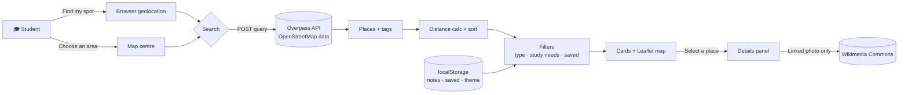

<div align="center">

# ☕ StudyCafe

### Off campus. On task.

**The study-spot finder for Western students who are done fighting for a seat in Weldo.**

Find cafés and quiet corners around London, filter them by what actually matters when you study, and keep your own notes on the places worth coming back to.


[Why StudyCafe](#-why-studycafe) · [Features](#-what-it-does-today) · [Quick start](#-quick-start) · [How it works](#-how-it-works) · [Roadmap](#-roadmap-the-western-edition) · [Contributing](#-contributing)

</div>

---

## 🟣 Why StudyCafe

It's week 7. Weldon is at capacity by 10 a.m., Taylor has one open chair next to someone eating chips, and the UCC sounds like a concert. You have a midterm on Thursday and zero desire to spend another four hours staring at the same campus walls.

There are dozens of good places to study within a short bus ride of campus. Cafés on Richmond Row, quiet spots in Wortley Village, warm corners in Old East Village, places near Masonville. The problem is that nobody tells you which ones have outlets, which ones let you stay three hours on one latte, and which ones turn into a lunch rush at noon.

**StudyCafe exists to fix that.** It's a map-first study-spot finder built for Western students who want a change of scenery without gambling on whether the place will actually work for studying.

> **The goal:** make "where should I study today?" a ten-second decision instead of a twenty-minute walk.

### Who it's for

| You are… | StudyCafe helps you… |
|---|---|
| 📚 **Burnt out on campus libraries** | Discover nearby cafés you've walked past a hundred times and never tried |
| 🏠 **Living off campus** | Find a spot near home instead of commuting to campus just to study |
| 👥 **Planning a group study session** | Flag places that can actually fit four people and a whiteboard of energy |
| 🌙 **A night owl** | Track which spots stay open late once the libraries close |
| 🆕 **New to London** | Explore the city one café at a time instead of staying in the campus bubble |

---

## ✨ What it does today

The current build is a fully working, zero-dependency web app. Everything below works right now.

### 🗺️ Find places around you
- **One-tap location search.** Hit **Find my spot**, allow location access, and see cafés and restaurants nearby.
- **1–10 km search radius** with a slider, so you can stay walking-distance or go a bus ride out.
- **Choose an area on the map.** Location blocked? Pan the map to any neighbourhood and hit **Search this map area**. Perfect for scouting Richmond Row from your bed.
- **Nearest-first results** with straight-line distances.

### 🎯 Filter for how you study
Six study filters, combined with AND logic:

`Quiet` · `Wi-Fi` · `Power outlets` · `Open late` · `Group-friendly` · `Pet-friendly`

Wi-Fi uses OpenStreetMap's recorded wireless access. Everything else is powered by **your own study notes**, so the filters get smarter the more places you visit. Unknown stays unknown: StudyCafe never pretends a place has outlets just because it might.

### 📝 Keep personal study notes
Every place card has **Add / edit study notes**. Mark each feature Yes, No or Unknown after you visit. Notes stay in your browser and instantly power the filters.

### ♥ Save your favourites
Heart a place to save it. Toggle **Saved** in the nav to see only your go-to spots in the current results.

### 🔍 Rich venue details
Click a place to see cuisine, opening hours, website and phone where they're recorded in OpenStreetMap, plus a properly licensed venue photo from Wikimedia Commons when one is linked, with full author and license attribution.

### 🎨 Built to feel good
- **Split, List and Map views** with synced hover and focus between cards and map pins
- **Light and dark mode** that follows your device until you choose
- **Accessible by default:** keyboard navigation, visible focus rings, 44 px touch targets, ARIA labels, skip link and reduced-motion support
- **Demo mode** with fictional places, so you can try it without sharing your location

---

## 🚀 Quick start

No API keys. No billing account. No `npm install`. Just a static folder.

```bash
git clone https://github.com/<your-username>/StudyCafe.git
cd StudyCafe
python3 -m http.server 8000
```

Open **http://localhost:8000**, then either:

1. Click **Find my spot** and allow location access, or
2. Click **Choose an area on the map** and search any area you like, or
3. Click **Just exploring? Try the demo** to play with fictional listings.

> ⚠️ Browsers only allow location access on `https://` or `localhost`. Opening `index.html` directly from your file system won't work for live search.

### Deploy to GitHub Pages

1. Push the project files to the **root** of your repository.
2. Go to **Settings → Pages → Deploy from a branch → `main` → `/ (root)`**.
3. Use the HTTPS address GitHub gives you. Done. Location works because Pages serves over HTTPS.

---

## 🧠 How it works



**The short version:**

1. Your coordinates (or the map centre) go to the public **Overpass API**, which returns every `amenity=cafe` and `amenity=restaurant` within your radius.
2. StudyCafe calculates straight-line distance with the haversine formula and sorts nearest-first.
3. Filters run **entirely in your browser**. No extra network requests when you toggle a chip.
4. Your notes, saved places and theme live in `localStorage`. If storage is blocked, they still work for the session.
5. Photos are only fetched for the place you select, only from Wikimedia Commons, and only shown when the license metadata checks out.

### Built-in protections for shared public services

| Guard | What it does |
|---|---|
| ⏱️ **15-second cooldown** | Prevents rapid repeat searches against Overpass |
| 💾 **5-minute in-memory cache** | Identical searches reuse previous results |
| ⌛ **Request timeouts** | 30 s for search, 10 s for photo metadata |
| 🧩 **Photo cache cap** | At most 50 photo lookups kept in memory, deduplicated |
| 🔒 **Safe rendering** | All venue data is inserted as text, never as HTML. Websites are restricted to `http`/`https` with no embedded credentials |

---

## 📁 Project structure

```
StudyCafe/
├── index.html          # Semantic page structure and controls
├── styles.css          # Design tokens, light/dark themes, responsive layout, motion
├── app.js              # Geolocation, Overpass search, distance, map and render pipeline
├── ui.js               # Cards, favourites, study notes, filters, theme, views
├── details.js          # Venue details and licensed Wikimedia Commons photos
├── config.js           # Tile and Overpass endpoints (swap providers here)
├── assets/
│   └── cafe-scene.svg  # Local illustration used for cards and hero
├── FULL-CODE.md        # Every source file in one place for quick review
└── README.md
```

**Tech stack:** HTML, CSS and vanilla JavaScript modules · [Leaflet 1.9.4](https://leafletjs.com/) · [OpenStreetMap](https://www.openstreetmap.org/) tiles · [Overpass API](https://overpass-api.de/) · [Wikimedia Commons API](https://commons.wikimedia.org/) · DM Sans and Fraunces from Google Fonts

---

## 🛣️ Roadmap: the Western Edition

StudyCafe is being rebuilt around one campus and one city. Here's where it's headed.

### Phase 1 · Make it feel like Western 🟣
- [ ] Purple-forward palette and Mustang-spirited copy (original design, no official Western marks)
- [ ] Default the map to **Western's campus** instead of downtown Toronto
- [ ] Show **distance from campus** on every card, not just distance from you
- [ ] Neighbourhood quick-picks: **Richmond Row · Downtown · Old East Village · Wortley Village · Masonville**
- [ ] Demo mode rewritten with London-flavoured fictional spots

### Phase 2 · Built for how students actually study 📚
- [ ] **Exam season mode:** highlight late-night spots during midterms and finals
- [ ] **Real "open now" and "open late"** computed from opening hours, not just personal notes
- [ ] **Getting there:** walking time and transit guidance from campus
- [ ] **Vibe tags:** lo-fi quiet, buzzing, group tables, cheap coffee, no laptop limits
- [ ] **Budget filter** for when OSAP hasn't hit yet

### Phase 3 · Powered by Western students 🤝
- [ ] **Community study reports** for noise, outlets, Wi-Fi and seating, so one student's visit helps everyone
- [ ] **Study Score** calculated only once there's enough verified data (currently shown as pending, on purpose)
- [ ] **Shareable spot lists** like "Best spots for a 3-hour grind" or "Group project HQs"
- [ ] Optional accounts so saved places sync across laptop and phone
- [ ] Moderation and reporting before any community content goes live

### Phase 4 · Beyond cafés 🌱
- [ ] Public library branches, study-friendly common spaces and seasonal outdoor spots
- [ ] Campus-adjacent hidden gems submitted by students
- [ ] Partnerships with student groups to promote study spots during exam season

---

## 🔐 Privacy

StudyCafe is designed to know as little about you as possible.

| Data | Where it goes | Kept? |
|---|---|---|
| Your coordinates | Sent to Overpass **only when you search** | Not stored by StudyCafe |
| Map view | Tile requests reveal the area you're viewing to OpenStreetMap | Not stored by StudyCafe |
| Study notes | Your browser's `localStorage` | Only on your device |
| Saved places | Your browser's `localStorage` (as place IDs) | Only on your device |
| Theme choice | Your browser's `localStorage` | Only on your device |

No accounts, no analytics, no cookies, no tracking.

---

## ⚠️ Honest limitations

StudyCafe would rather tell you "unknown" than guess.

- **OpenStreetMap coverage varies.** Some London cafés may be missing or have incomplete tags. You can [fix the map](https://www.openstreetmap.org/fixthemap) yourself.
- **Distances are straight-line**, not walking or transit routes.
- **No ratings or reviews.** OpenStreetMap doesn't provide them, and StudyCafe doesn't fake them. Demo listings show clearly labelled sample ratings.
- **Opening hours are shown as recorded**, not evaluated as "open now." Always confirm with the venue.
- **Noise, outlets and study suitability are unverified** unless you've added a note.
- **Card artwork is illustrative**, not a photo of the venue.

### Using public services responsibly

The OpenStreetMap tile server and the public Overpass instance are free, best-effort community services. This project is suited to modest personal and portfolio traffic. If usage grows, switch providers or self-host by updating `config.js`.

- [OSM Tile Usage Policy](https://operations.osmfoundation.org/policies/tiles/)
- [Overpass API Commons](https://dev.overpass-api.de/overpass-doc/en/preface/commons.html)

Please keep attribution, normal browser caching and referrers in place, and never prefetch tiles or bulk-download data.

---

## 🤝 Contributing

Western students, this is your project too.

**Found a great study spot?** Open an issue with the name, neighbourhood, and what makes it good (outlets, quiet hours, Wi-Fi, group seating).

**Found a missing or wrong café on the map?** Fix it at the source on [OpenStreetMap](https://www.openstreetmap.org/fixthemap). Every edit improves StudyCafe and every other map app that uses OSM.

**Want to write code?**
1. Fork the repo and create a branch: `git checkout -b feature/exam-season-mode`
2. Run it locally with `python3 -m http.server 8000`
3. Keep it dependency-free and accessible (keyboard, contrast, reduced motion)
4. Open a pull request describing what changed and why

Good first issues: the **Phase 1** roadmap items above.

---

## ❓ FAQ

<details>
<summary><b>Is this an official Western University app?</b></summary>
<br>
No. StudyCafe is an independent student project and is not affiliated with, endorsed by, or sponsored by Western University. "Western" is used only to describe the intended audience.
</details>

<details>
<summary><b>Do I need an API key or account?</b></summary>
<br>
No. Everything runs on free, open services, and there are no accounts.
</details>

<details>
<summary><b>Why does a café show "Wi-Fi unverified"?</b></summary>
<br>
Because nobody has recorded its Wi-Fi in OpenStreetMap yet. Add a study note after your visit and the Wi-Fi filter will use it.
</details>

<details>
<summary><b>Why is the Study Score always pending?</b></summary>
<br>
A score built on missing data would be misleading. It will appear once community reports on noise, seating, outlets and Wi-Fi exist.
</details>

<details>
<summary><b>Will my notes sync to my phone?</b></summary>
<br>
Not yet. Notes and saved places live in the browser you used. Cross-device sync is on the Phase 3 roadmap.
</details>

<details>
<summary><b>Search says "Please wait 15 seconds." Why?</b></summary>
<br>
That's the built-in cooldown that keeps StudyCafe a good citizen on shared public servers. Repeating the exact same search within five minutes is instant, because results are cached.
</details>

---

## 🙏 Credits

- Place data © [OpenStreetMap contributors](https://www.openstreetmap.org/copyright), available under the ODbL
- Map rendering by [Leaflet](https://leafletjs.com/)
- Search powered by the [Overpass API](https://overpass-api.de/)
- Venue photos from [Wikimedia Commons](https://commons.wikimedia.org/), credited individually with author and license
- Typefaces: [DM Sans](https://fonts.google.com/specimen/DM+Sans) and [Fraunces](https://fonts.google.com/specimen/Fraunces)

---

<div align="center">

**Built by a Western student, for Western students.** 🟣

*Close the laptop on campus. Open it somewhere new.*

</div>
